<p align="center">
  
</p>

# ShopLite

[](LICENSE)
[](docker-compose.yml)
[](backend/Dockerfile)
[](#)
[](casaos/README.md)

**[Try ShopLite](https://pos.nodedr.com/)** · **[Case study](https://www.raktimranjit.com/projects/nodedr-pos)** · **[Maintainer: Raktim Ranjit](https://www.raktimranjit.com/)**

<p align="center">
  
</p>

---

ShopLite is a **free, open-source, offline-first** point-of-sale and inventory
management system for small retail shops. It runs on a machine in your shop with
Docker Compose, so checkout and inventory work **without internet and without a
subscription**. Your data stays on that machine by default.

It is built for a barcode-scanner counter: **scan an item → press Enter to
check out → print or download the receipt in one click**. No USB scanner? Scan
barcodes and QR codes from a phone or tablet camera instead. No barcode at all?
Generate one and print a label, right from the app.

Open it at **`http://<machine>:1994`** — from the shop's own machine, or from any
phone, tablet or PC on the same Wi-Fi.

## Quick start

| I have… | Best option | Needs |
| --- | --- | --- |
| 🖥️ **Windows 10 or 11** | [**Microsoft Store app**](https://apps.microsoft.com/store/detail/9N4D0GW2XZ37?cid=DevShareMCLPCS) | nothing else |
| 🐳 **Docker host, NAS or VPS** | [**One-command Docker install**](#one-command-install) | Docker |
| 🏠 **CasaOS / ZimaOS box** | [**CasaOS app**](casaos/README.md) | nothing else |

### One-command install (Windows, macOS, or Linux)

Paste the command for your terminal. It checks requirements, installs Docker
where supported, then downloads and starts ShopLite. On first use, Windows may
ask for one restart while it enables WSL2 — run the same command again after
restarting.

**Windows PowerShell**

```powershell
irm https://raw.githubusercontent.com/Raktim94/nodedr-pos/master/scripts/quickstart.ps1 | iex
```

**macOS / Linux Terminal**

```sh
curl -fsSL https://raw.githubusercontent.com/Raktim94/nodedr-pos/master/scripts/quickstart.sh | bash
```

When it finishes, open <http://localhost:1994>. On another device on the same
Wi-Fi, open `http://<that-machine-ip>:1994`.

Already cloned? Use the bundled installer to build both images and start the
stack:

```bash
git clone https://github.com/HimashGuruge/POS-System.git
cd POS-System
./install.sh
```

> **Running it on a VPS or a public domain?** Copy `.env.example` to `.env`,
> set `FRONTEND_ORIGIN=https://pos.yourdomain.com`, `COOKIE_SECURE=true` and
> `PUBLIC_BASE_URL=https://pos.yourdomain.com`, and put HTTPS in front of the
> app (Caddy/Nginx + Let's Encrypt). See [Where to run it](#where-to-run-it).

### First launch

1. **Create the admin account** — name, e-mail, password. Keep it safe.
2. **Shop details** — name, address, currency, and your GST number if you charge GST.
3. Land on the dashboard, then, in order:
   - **Inventory → Add product** (or **Bulk import** a CSV/Excel file).
   - **Settings → Invoice & signature** — pick the bill style, upload your signature.
   - **Settings → Payments** — add your UPI id to show a QR at checkout.
   - **POS Checkout** — scan or search products and sell.
4. *Optional:* **Settings → Features** — turn on **IMEI / serial numbers &
   warranty** if you sell phones, laptops or appliances (off by default).
5. *Optional:* connect your online store — **Settings → Online stores /
   Integrations** ([guide](docs/CUSTOM_STORE.md)).

The full step-by-step tutorial with a screenshot gallery is in
[`TUTORIAL.md`](TUTORIAL.md).

## How it works

```
  Browser / LAN tablet
        │  http://<machine>:1994   (the ONLY exposed port)
        ▼
┌──────────────────────┐   /api/* proxied server-side   ┌──────────────────────┐
│   frontend  :1994    │ ──────────────────────────────▶ │  backend (internal)  │
│   Next.js / React     │ ◀────────────────────────────── │  Express + Prisma    │
└──────────────────────┘   (internal Docker network)      └──────────┬───────────┘
                                                                       │
                                                                       ▼
                                                         SQLite (nodedr-pos_data)
                                                         (named Docker volume)
```

**One port, one origin.** The browser only ever talks to the frontend on port
**1994**. Next.js proxies every `/api/*` request to the backend over the
internal Docker network — the backend is **not** published to the host at all.
That means it works from **any device on the LAN**, session cookies are
first-party (no CORS fragility), and the API is not exposed on the network
(smaller attack surface). Both containers start with a single
`docker compose up`.

Receipts print through the browser's own print dialog, download as a
server-generated PDF, or — via **Print via USB** — go straight to a USB thermal
printer as raw ESC/POS bytes from the backend.

## Features

- **Guided onboarding** — first launch walks you through creating the admin
  account and configuring the shop (name, address, currency, GST, loyalty)
  before you see the dashboard.
- **Barcode-driven POS** — scan to add to the cart, scan again to bump
  quantity, press **Enter** to finalize. Unknown barcodes surface a toast
  instead of blocking the register. Camera scanning works as a fallback.
- **GST / tax** — per-product GST rates with HSN/SAC codes. The price you enter
  is MRP (GST-inclusive, as required by law); GST is broken out as CGST/SGST on
  the receipt, alongside your GSTIN. Toggle GST on/off in settings.
- **Discounts** — per-sale percentage or flat-amount discount, *and* a standing
  per-product discount % set once in Inventory that applies automatically.
- **Loyalty program** — customers earn points on every purchase, redeemable as
  a discount at checkout. Configurable earn rate and point value.
- **Customer dues ("udhaar")** — a cash sale can be paid short; the shortfall
  becomes a running due balance you can record payments against later.
- **Returns & exchanges** — look up any past bill from the register, return
  lines, and either refund them or fold them straight into a new sale as an
  exchange. Stock restocks automatically and the same unit can never be
  returned twice.
- **Store credit** — a refund can be kept as store credit and spent on a future
  purchase.
- **Multi-currency** — 20+ currencies (₹, $, €, £, HK$, …), switchable in
  settings; the symbol flows through the whole app and onto receipts.
- **Offline barcode & QR generator** — generate a valid EAN-13 in one click and
  print or download a label as PNG/JPG, fully offline.
- **Reference data & validation** — live GSTIN/PAN format checks, GST state-code
  decoding, and admin-imported HSN/SAC/PIN/IFSC CSVs for autocomplete.
- **Works on phones and tablets** — the nav collapses to a slide-out drawer,
  so the register is fully usable from a counter tablet or phone.
- **Customizable receipts** — set a header/footer; the receipt renders your
  branding, GST breakdown, discounts and loyalty summary.
- **Multiple payment methods** — Cash (with change), UPI, Card.
- **Staff accounts & roles** — an admin plus any number of cashier logins with
  granular permissions.
- **Sales history** — searchable past invoices with a detail view and one-click
  receipt reprint.
- **Inventory management** — scan a known barcode to edit stock; low-stock
  alerts on the dashboard; an "allow negative stock" setting when counts run
  behind reality.
- **Print or download receipts, three ways** — Print (browser dialog),
  Download PDF, or Print via USB (raw ESC/POS). An auto-print option can skip
  the extra click.
- **Sales dashboard with charts** — revenue trend, top sellers, payment mix,
  top loyalty customers, and a one-click CSV export.
- **Runs anywhere Docker runs** — the same `docker compose up` that runs it on
  a shop's counter also runs it unmodified on any VPS/cloud provider.
- **Zero external calls at runtime** — once built, the app never talks to
  anything outside your machine.

## Where to run it

The whole app is just the two containers in [`docker-compose.yml`](docker-compose.yml),
so `git clone` + `docker compose up` is all you need anywhere Docker runs.

- **On your own machine or shop LAN (recommended default).** The register, the
  database, and the receipts never leave a box you physically control — no
  provider has your sales data and there's nothing to keep paying for. HTTP is
  fine because only the shop's trusted network can reach it. No `.env` needed.
- **On a VPS / cloud host, if you want it.** The identical `docker compose up`
  also runs on any VPS if you'd rather manage one instance remotely or reach it
  from more than one location. Nothing in the compose file changes: set
  `FRONTEND_ORIGIN` to your `https://` URL and `COOKIE_SECURE=true`, put a
  reverse proxy with real HTTPS in front, and firewall the port. A publicly
  reachable service is not a local box, so treat it that way (see
  [Security](#security)).

## Hardware

- **Barcode scanner** — any USB scanner that acts as a keyboard works out of
  the box. The [`useBarcodeScanner`](frontend/hooks/useBarcodeScanner.ts) hook
  tells scanner input apart from a human typing by inter-keystroke timing.
- **Camera barcode & QR scanning** — POS and Add/Edit Product have a **Scan
  with camera** button that decodes barcodes and QR codes in the browser
  ([`CameraScannerModal`](frontend/components/CameraScannerModal.tsx)). Cameras
  only work on a secure context (`https://` or `localhost`); the bundled Caddy
  HTTPS front door, a browser flag, or a Cloudflare Tunnel all fix it — see
  [docs/ROADMAP.md](docs/ROADMAP.md) for what's verified.
- **Barcode & QR label generator** — the **Generate** button produces a valid
  EAN-13 from the in-store range and renders it client-side (no network call).
- **Printing & receipts** — **Print** (browser dialog, any printer),
  **Download PDF** (server-side `pdfkit`), or **Print via USB** (raw ESC/POS to
  a USB thermal printer, Linux only). Any ESC/POS 58 mm/80 mm printer works.

  The full printer setup, root requirements, compatibility list and
  troubleshooting are in [`docs/ROADMAP.md`](docs/ROADMAP.md).

## Back up, update, reset

- **Back up your data** — the database lives in the `nodedr-pos_data` Docker
  volume. Copy it out with a throwaway container:

  ```bash
  docker run --rm -v nodedr-pos_data:/data:ro -v "$PWD":/backup alpine \
    cp /data/pos.db /backup/pos-backup-$(date +%Y%m%d).db
  ```

- **Update** — Docker and CasaOS installs include an updater container; admins
  see an **"Update available"** banner in the app. Go to **Settings →
  Updates → Update now** and confirm your password. The updater downloads the
  exact version, swaps the two app containers (about a minute) and reloads. It
  only ever touches the backend and frontend containers; the data volume is
  never touched. By hand: `docker compose pull && docker compose up -d`.

- **Reset / clear data** — to wipe everything and re-run onboarding, stop the
  stack and remove the volume (`docker compose down -v`), then start again. To
  remove just the volume: `docker volume rm nodedr-pos_data` (stack must be
  stopped first).

## Project structure

```
nodedr-pos/
├── docker-compose.yml         # declares the nodedr-pos_data named volume
├── docs/screenshots/          # README images
├── docs/                      # API.md, ROADMAP.md, CUSTOM_STORE.md, verifactu.md, SECURITY-AUDIT.md
├── casaos/                    # CasaOS/ZimaOS app store manifest + assets
├── packaging/                 # optional desktop tray helper
├── backend/
│   ├── Dockerfile
│   ├── prisma/schema.prisma  # User, ShopSettings, Product, Invoice, InvoiceItem, Return, …
│   └── src/
│       ├── server.js
│       ├── routes/           # auth, settings, products, invoices, returns, print, external
│       ├── middleware/auth.js
│       └── lib/              # prisma client, JWT secret, currencies, receipt HTML + PDF, ESC/POS
└── frontend/
    ├── Dockerfile
    ├── next.config.ts        # /api → backend proxy (rewrites)
    ├── app/
    │   ├── onboarding/, login/                         # unauthenticated flows
    │   └── (app)/dashboard, pos, inventory, customers, sales, settings, team
    ├── components/           # AppShell, GlobalSearch, CameraScannerModal, ui/*, …
    ├── lib/                  # api client, format helpers, barcode.ts, masters.ts (reference data)
    └── hooks/                # useBarcodeScanner, useProducts, useCustomers, useInvoices, …
```

## Tech stack

| Layer      | Choice |
| ---------- | ------ |
| Frontend   | Next.js (App Router), React, TypeScript, Tailwind CSS |
| Data layer | TanStack Query, react-hook-form + Zod |
| Backend    | Node.js, Express, Zod validation, helmet, rate limiting |
| Database   | SQLite via Prisma ORM (`better-sqlite3`), persisted in a Docker volume |
| Auth       | bcrypt, HttpOnly JWT cookie, admin/cashier roles |
| API access | Browser → Next.js (:1994) → server-side `/api` proxy → backend |
| Hardware   | Browser print dialog + `pdfkit`; a React hook for the barcode scanner |
| Barcodes   | `jsbarcode` (EAN-13/CODE128) + `qrcode`, rendered client-side |
| Charts     | `recharts` |
| Deployment | Docker Compose, two `node:24-alpine` multi-stage images |

## Local development (without Docker)

```bash
# Terminal 1 — backend on :4000
cd backend
cp .env.example .env
npm install
npm run prisma:migrate:dev
npm run dev

# Terminal 2 — frontend on :1994 (proxies /api to the backend)
cd frontend
npm install
BACKEND_URL=http://localhost:4000 npm run dev
```

Open `http://localhost:1994`. The browser only talks to :1994; the dev server
proxies `/api/*` to `BACKEND_URL` (default `http://localhost:4000`).

## API & integrations

- **App API** — all endpoints are under `/api`, reached through the frontend
  proxy. Full reference in [`docs/API.md`](docs/API.md).
- **External Stock API** — a separate, key-authenticated API for an e-commerce
  storefront to read live stock and report its own sales back. Setup, endpoints
  and the webhook (HMAC-signed stock pushes) are in
  [`docs/CUSTOM_STORE.md`](docs/CUSTOM_STORE.md).
- **Online stores** — connect WooCommerce/Shopify or a custom website in
  **Settings → Online stores** ([guide](docs/CUSTOM_STORE.md)).

## Security

- **Passwords** — bcrypt (cost 12); timing-uniform login; rate-limited.
- **Sessions** — `HttpOnly`, `SameSite=Lax` JWT cookie (HS256, algorithm
  pinned); every request re-checks the account is still active.
- **Authorization** — all data routes require auth; settings and staff
  management require the `admin` role. The last active admin can't be demoted.
- **Server-authoritative money** — prices, tax, discounts and loyalty are
  computed server-side; the client only sends ids, quantities and intent.
- **Input validation** — every write endpoint validates with Zod (allowlisted
  fields); all DB access is parameterized via Prisma.
- **Reduced surface** — the backend is not published to the host; only the
  frontend (:1994) is reachable, and it proxies to the backend privately.
- **Secrets** — the JWT signing secret is auto-generated on first boot and
  stored in the data volume, never in the repo.

Designed for a **trusted local network**. It's HTTP by default; if you expose it
beyond the counter, terminate HTTPS in front of it and set
`COOKIE_SECURE=true`. Full review: [`docs/SECURITY-AUDIT.md`](docs/SECURITY-AUDIT.md).

## What's new in 1.6

- **Spain VERI\*FACTU (implemented, not certified)** — every sale becomes a
  simplified invoice in a tamper-evident, hash-chained log; returns become
  corrective invoices; receipts print the AEAT QR code. Off by default and
  invisible outside Spain. Not claimed compliant — see
  [`docs/verifactu.md`](docs/verifactu.md).

## What's new in 1.5

- **Find products online** — search free community databases by name or
  barcode, with validation and warnings.
- **Product photos** — add a photo when registering or editing a product.
- **Customer display on any device** — show the cart and UPI QR on a phone,
  tablet or second screen, live.
- **Online orders** — website orders move through New → Packing → Ready →
  Collected; connect WooCommerce, Shopify or your own site.
- **Purchasing** — suppliers and purchase orders.

## Contributing

Issues and PRs are welcome — see [`CONTRIBUTING.md`](CONTRIBUTING.md) for dev
setup and the conventions this codebase leans on (server-authoritative money,
ESC/POS printer quirks, barcode-scanner HID handling). This is a small, focused
tool — please keep contributions aligned with "offline-first single-shop POS".
This project follows the [Contributor Covenant](CODE_OF_CONDUCT.md).

## License

Copyright © 2026 [Nodedr Infotech Private Limited](https://www.nodedr.com/)
and Raktim Ranjit. Licensed under the
[GNU Affero General Public License v3.0](LICENSE) (AGPL-3.0).

In short: you're free to self-host, use, and modify this software for your
shop. If you modify it and run that modified version as a network service for
others, you must make your modified source available to those users under the
same license. A [commercial licence](COMMERCIAL-LICENSE.md) is available on
request for use without the AGPL obligations. The ShopLite name and logo are
not covered by the AGPL.

Maintainers: [`MAINTAINERS.md`](MAINTAINERS.md) ·
[Case study](https://www.raktimranjit.com/projects/nodedr-pos) ·
Maintainer: [Raktim Ranjit](https://www.raktimranjit.com/)
